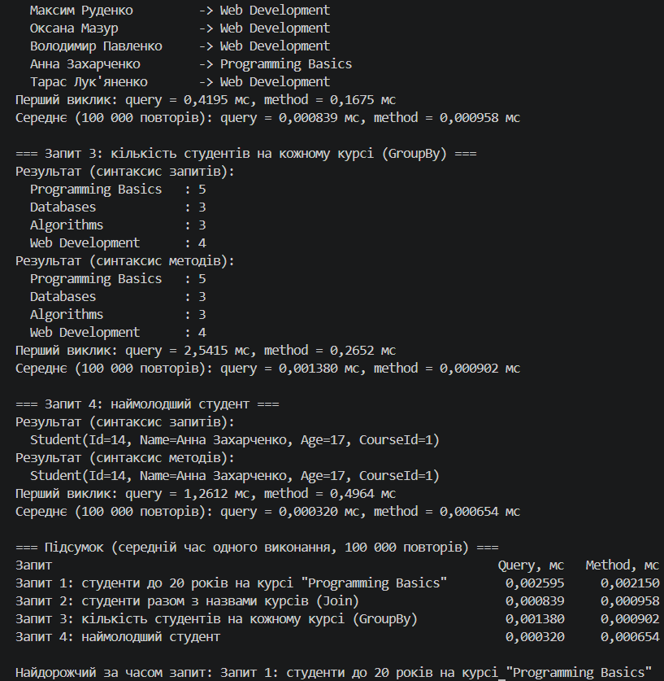

# Звіт з лабораторної роботи №10

**З дисципліни:** Об'єктно-орієнтоване програмування
**Тема:** LINQ: фільтри, join, агрегації. Продуктивність.
**Виконав:** студент Ткаченко Максим **Варіант:** №2

---

## 1. Мета роботи

Навчитися ефективно використовувати LINQ для фільтрації, об'єднання (join) та агрегації даних, а також аналізувати продуктивність LINQ-запитів.

## 2. Індивідуальне завдання (Варіант 2)

**Сценарій:** Управління студентами.

**Сутності:** `Student (Id, Name, Age, CourseId)`, `Course (Id, Title, Credits)`.

**Запити** (кожен реалізовано в синтаксисі запитів і в синтаксисі методів):

1. Знайти всіх студентів віком до 20 років (`Age < 20`), які навчаються на курсі "Programming Basics".
2. Об'єднати студентів з їхніми курсами, вивести ім'я студента та назву курсу.
3. Підрахувати кількість студентів на кожному курсі.
4. Знайти найменшого (наймолодшого) студента.

## 3. Структура проєкту

- `lab10v2/Student.cs` — клас сутності студента.
- `lab10v2/Course.cs` — клас сутності курсу.
- `lab10v2/DataSeed.cs` — тестові дані (4 курси, 15 студентів).
- `lab10v2/Program.cs` — виконання чотирьох LINQ-запитів в обох синтаксисах, вимірювання часу через `Stopwatch`, підсумкова таблиця.
- `lab10v2/lab10v2.csproj` — файл проєкту (.NET 8).
- `.gitignore` — виключає службові файли .NET, VS Code та ОС.

## 4. Реалізація запитів

| № | Операції LINQ | Синтаксис запитів | Синтаксис методів |
|---|---------------|-------------------|-------------------|
| 1 | `join`, `where` | `from ... join ... where ... select` | `Join().Where().Select()` |
| 2 | `join`, проєкція | `from ... join ... select new {...}` | `Join(...)` |
| 3 | `GroupBy`, `Count`, `join` | `group ... by ... into g join ...` | `GroupBy().Join()` |
| 4 | сортування / `Min` | `orderby ... First()` | `MinBy()` |

## 5. Вимірювання продуктивності

Час вимірюється за допомогою `System.Diagnostics.Stopwatch`:

- **перший виклик** — один запуск запиту (містить JIT-компіляцію та створення делегатів);
- **середній час** — після прогріву (1000 запусків) виконується 100 000 повторів, результат ділиться на кількість повторів.

Запити викликають `ToList()` / `First()` / `MinBy()`, тому виконуються негайно (відкладене виконання LINQ не спотворює вимірювання).

### Результати виконання

```
=== Запит 1: студенти до 20 років на курсі "Programming Basics" ===
Результат (синтаксис запитів):
  Student(Id=1, Name=Олександр Коваль, Age=18, CourseId=1)
  Student(Id=2, Name=Марія Шевченко, Age=19, CourseId=1)
  Student(Id=14, Name=Анна Захарченко, Age=17, CourseId=1)
Результат (синтаксис методів):
  Student(Id=1, Name=Олександр Коваль, Age=18, CourseId=1)
  Student(Id=2, Name=Марія Шевченко, Age=19, CourseId=1)
  Student(Id=14, Name=Анна Захарченко, Age=17, CourseId=1)
Перший виклик: query = 5,2838 мс, method = 0,3402 мс
Середнє (100 000 повторів): query = 0,002595 мс, method = 0,002150 мс

=== Запит 2: студенти разом з назвами курсів (Join) ===
Результат (синтаксис запитів):
  Олександр Коваль       -> Programming Basics
  Марія Шевченко         -> Programming Basics
  Іван Бондаренко        -> Programming Basics
  Софія Ткаченко         -> Programming Basics
  Андрій Мельник         -> Databases
  Наталія Кравчук        -> Databases
  Дмитро Олійник         -> Databases
  Катерина Лисенко       -> Algorithms
  Богдан Гриценко        -> Algorithms
  Юлія Савченко          -> Algorithms
  Максим Руденко         -> Web Development
  Оксана Мазур           -> Web Development
  Володимир Павленко     -> Web Development
  Анна Захарченко        -> Programming Basics
  Тарас Лук'яненко       -> Web Development
Результат (синтаксис методів):
  Олександр Коваль       -> Programming Basics
  Марія Шевченко         -> Programming Basics
  Іван Бондаренко        -> Programming Basics
  Софія Ткаченко         -> Programming Basics
  Андрій Мельник         -> Databases
  Наталія Кравчук        -> Databases
  Дмитро Олійник         -> Databases
  Катерина Лисенко       -> Algorithms
  Богдан Гриценко        -> Algorithms
  Юлія Савченко          -> Algorithms
  Максим Руденко         -> Web Development
  Оксана Мазур           -> Web Development
  Володимир Павленко     -> Web Development
  Анна Захарченко        -> Programming Basics
  Тарас Лук'яненко       -> Web Development
Перший виклик: query = 0,4195 мс, method = 0,1675 мс
Середнє (100 000 повторів): query = 0,000839 мс, method = 0,000958 мс

=== Запит 3: кількість студентів на кожному курсі (GroupBy) ===
Результат (синтаксис запитів):
  Programming Basics   : 5
  Databases            : 3
  Algorithms           : 3
  Web Development      : 4
Результат (синтаксис методів):
  Programming Basics   : 5
  Databases            : 3
  Algorithms           : 3
  Web Development      : 4
Перший виклик: query = 2,5415 мс, method = 0,2652 мс
Середнє (100 000 повторів): query = 0,001380 мс, method = 0,000902 мс

=== Запит 4: наймолодший студент ===
Результат (синтаксис запитів):
  Student(Id=14, Name=Анна Захарченко, Age=17, CourseId=1)
Результат (синтаксис методів):
  Student(Id=14, Name=Анна Захарченко, Age=17, CourseId=1)
Перший виклик: query = 1,2612 мс, method = 0,4964 мс
Середнє (100 000 повторів): query = 0,000320 мс, method = 0,000654 мс

=== Підсумок (середній час одного виконання, 100 000 повторів) ===
Запит                                                             Query, мс   Method, мс
Запит 1: студенти до 20 років на курсі "Programming Basics"        0,002595     0,002150
Запит 2: студенти разом з назвами курсів (Join)                    0,000839     0,000958
Запит 3: кількість студентів на кожному курсі (GroupBy)            0,001380     0,000902
Запит 4: наймолодший студент                                       0,000320     0,000654

Найдорожчий за часом запит: Запит 1: студенти до 20 років на курсі "Programming Basics"
```

| Запит | Query, мс | Method, мс |
|-------|-----------|------------|
| 1. Фільтрація + join | 0,002595 | 0,002150 |
| 2. Join | 0,000839 | 0,000958 |
| 3. GroupBy + Count | 0,001380 | 0,000902 |
| 4. Наймолодший студент | 0,000320 | 0,000654 |

### Скріншот виконання програми

<<<<<<< HEAD


=======


>>>>>>> 0408a5275ac052d28552369237da034614400a19

## 6. Висновок

У роботі реалізовано чотири LINQ-запити до колекцій студентів та курсів у двох синтаксисах. Обидва синтаксиси компілюються в однакові виклики методів розширення, тому їхня продуктивність практично однакова, а різниця у вимірах лежить у межах похибки. Перший виклик будь-якого запиту суттєво повільніший за наступні через JIT-компіляцію. Найдорожчими виявилися запити з `Join` та `GroupBy`, оскільки вони будують допоміжні структури (хеш-таблиці) і створюють проміжні об'єкти; найдешевшим — пошук наймолодшого студента (`MinBy`) — один прохід колекцією без додаткових виділень пам'яті. На продуктивність впливають: розмір колекції, кількість проміжних колекцій і анонімних об'єктів, використання `ToList()`, порядок операцій (фільтрувати краще до `Join`) та вибір методу (`MinBy` швидший за `OrderBy().First()`, бо не сортує всю колекцію).

## 7. Відповіді на контрольні питання

1. **Query vs method syntax.** Query-синтаксис більш читабельний для `join`, `group by` та складних запитів; method-синтаксис — для простих ланцюжків і методів без query-аналога (`MinBy`, `Take`, `Skip`). Компілятор перетворює query-синтаксис на виклики методів, тож за швидкістю вони однакові.
2. **`Join` і `GroupJoin`.** `Join` поєднує елементи двох колекцій за ключем (внутрішнє з'єднання). `GroupJoin` повертає для кожного елемента першої колекції групу відповідних елементів другої (основа для left join). Вони ефективні, бо використовують хеш-таблицю за ключем замість вкладених циклів O(n·m).
3. **Агрегатні операції:** `Count` — кількість елементів, `Sum` — сума, `Average` — середнє, `Min`/`Max` — мінімум/максимум, `Aggregate` — довільне накопичення значення.
4. **Вимірювання:** через `Stopwatch` із прогрівом і багатьма повтореннями (або BenchmarkDotNet). Впливають: JIT, розмір даних, відкладене виконання, кількість проміжних об'єктів, збирач сміття.
